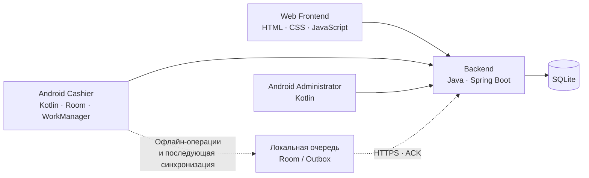

# Ples ERP

### Практическая система управления небольшим магазином

**От номенклатуры и поступлений до продаж, возвратов и мобильного рабочего места кассира.**

Проект создан для решения реальных задач собственного интернет-магазина и развивается как единая система с веб-интерфейсом, серверным API и отдельными Android-приложениями.

[Архитектура](docs/ARCHITECTURE.md) · [Возможности и статус](docs/FEATURES.md) · [HTML-витрина](index.html)

---

> **Ples ERP — собственный проект Igor-2020.** Разработка велась с использованием ИИ-инструментов в качестве помощника. Постановка задач, выбор направления развития, интеграция компонентов и проверка системы выполнялись в рамках работы над собственным магазином.

## О проекте

Ples ERP — это не учебный пример из туториала, а прикладное ПО, которое создавалось вокруг повседневных задач торговли. Главная цель — объединить учёт товаров и поступлений, продажи и возвраты, аналитику и мобильные инструменты в одной системе.

Система развивается по принципу: **практическая задача → реализация → проверка → постепенное развитие**. Витрина описывает фактические возможности и отдельно отмечает то, что ещё находится в работе.

## Мой вклад в проект

Я выступаю инициатором и владельцем проекта: формулирую задачи на основе процессов собственного магазина, определяю приоритеты, согласовываю архитектурные решения, организую разработку с использованием ИИ-инструментов, интегрирую компоненты и проверяю результат в рабочем процессе. Код создавался при помощи ИИ; проектные решения, постановка задач, интеграция и проверка — часть моей практической работы.

В портфолио я намеренно разделяю подтверждённые возможности, текущие ограничения и дальнейшие планы. Это не заявка на то, что каждая строка была написана вручную или что система уже готова к внедрению в любой компании.

## Инженерные задачи и решения

- **Единая бизнес-логика:** веб-клиент и Android-клиенты обращаются к общему Backend API.
- **Изоляция данных:** серверная модель предусматривает отдельную SQLite-базу магазина и проверку доступа на стороне сервера.
- **Работа при потере сети:** Android Cashier сохраняет операции локально и отправляет их через Outbox и WorkManager.
- **Контроль синхронизации:** локальная операция считается синхронизированной после подтверждения сервера, а не просто после появления сети.
- **Постепенное развитие:** компоненты развиваются поэтапно, без объявления незавершённых функций готовыми.

## Что входит в Ples ERP

| Компонент | Назначение | Технологии |
|---|---|---|
| **Backend** | REST API, авторизация, роли и доступ к магазину, бизнес-логика, операции с данными | Java 21, Spring Boot 3.5, SQLite |
| **Web Frontend** | Веб-интерфейс для повседневной работы с магазином | HTML, CSS, Vanilla JavaScript |
| **Android Cashier** | Мобильное рабочее место кассира с локальными операциями и последующей синхронизацией | Kotlin, Android, Room, WorkManager |
| **Android Administrator** | Мобильный интерфейс администратора для поступлений, номенклатуры, истории продаж и аналитики | Kotlin, Android |

Исходный код компонентов хранится в отдельных репозиториях. **Этот репозиторий предназначен для публичной презентации проекта, а не для распространения исходников основной системы.**

## Основные возможности

### Учёт и торговые операции
- Номенклатура и поиск товаров по штрихкоду.
- Журнал поступлений, просмотр деталей и работа с позициями поступления.
- Продажи и возвраты, включая многотоварные операции в Android Cashier.
- История продаж, информация о возвратах и расчётные показатели.
- Статистика по выручке, прибыли, чекам, возвратам, товарам и кассирам.

### Мобильная работа
- Отдельное приложение кассира и отдельное приложение администратора.
- Локальное сохранение кассовых операций в Android Cashier.
- Очередь операций и фоновая синхронизация с сервером.
- Идентификаторы операций для защиты от повторной обработки.
- Защищённое хранение мобильного токена в приложении администратора.

### Серверная часть
- Java REST API на Spring Boot.
- SQLite как хранилище данных.
- Разделение данных магазинов и проверки доступа на стороне сервера.
- Существующие API для веб-клиента и мобильных приложений.

Подробности и оговорки по состоянию реализации: [Возможности и статус](docs/FEATURES.md).

## Архитектура в одном взгляде

Ключевой принцип Android Cashier: **магазин должен иметь возможность продолжать продажи без интернета, а синхронизацию выполнять позже**. Онлайн-доступность и подтверждённая синхронизация конкретной операции рассматриваются как разные состояния.

## Технический подход

- Разделение ответственности между веб-клиентом, сервером и Android-приложениями.
- Общий Backend для клиентских приложений с проверками авторизации и доступа.
- Отдельная SQLite-база для каждого магазина в серверной модели данных.
- Для офлайн-кассы — локальная база, постоянная очередь операций, фоновые повторы и подтверждение от сервера.
- Постепенное развитие существующего решения вместо полного переписывания с нуля.

## Статус проекта

Ples ERP — **работающий, развивающийся проект**, а не заявление о завершённом коммерческом продукте для любого бизнеса. Базовые сценарии реализованы, но отдельные интерфейсы и функции продолжают дорабатываться. Перед использованием в другом магазине необходимы отдельное развёртывание, проверка бизнес-процессов, резервного копирования, безопасности и совместимости с конкретной инфраструктурой.

Примеры текущих ограничений:
- Печать этикеток в Android Administrator ещё не реализована полностью: элементы интерфейса печати не означают, что печать уже работает с физическим принтером.
- Полноценное резервное копирование и последующие этапы усиления аудита/безопасности остаются отдельными задачами развития.
- Публичная живая демонстрация и видеоматериалы будут добавлены после подготовки изолированного окружения с тестовыми данными.

## Репозитории компонентов

Исходный код основных компонентов хранится в **приватных репозиториях** и не открыт для публичного просмотра:

- `Backend-Ples-ERPv1` — серверная часть.
- `Frontend-Ples-ERPv1` — веб-интерфейс.
- `Android-Ples-ERP-Cashier` — приложение кассира.
- `Android-Ples-ERP-Administrator` — приложение администратора.

Публичная витрина не ведёт посетителя на страницы с отказом в доступе и не раскрывает расположение закрытых рабочих репозиториев. Для изучения проекта доступны публичные документы: [архитектура](docs/ARCHITECTURE.md), [возможности и статус](docs/FEATURES.md), [инженерный разбор](docs/CASE-STUDY.md) и [дорожная карта](docs/ROADMAP.md).

## Авторство и использование

**Инициатор проекта и владелец портфолио:** Igor-2020.

Этот репозиторий содержит презентационные материалы, документацию и HTML-витрину. Он **не предоставляет лицензию на исходный код основной Ples ERP** и не означает, что закрытые компонентные репозитории открыты для копирования или распространения. Права и лицензии на сторонние библиотеки определяются их собственными условиями.

## Дорожная карта

1. Включить публикацию статической витрины через GitHub Pages.
2. Подготовить скриншоты и короткое видео реальной работы приложений.
3. Поднять отдельную демонстрационную среду с синтетическими данными.
4. Проверить основные пользовательские сценарии на демонстрационном окружении.
5. Добавить ссылку на живую демонстрацию только после проверки её стабильности и безопасности.

---

**Ples ERP — создана из реальных задач небольшого магазина.**

*Практический проект. Постепенное развитие. Честный статус реализации.*

