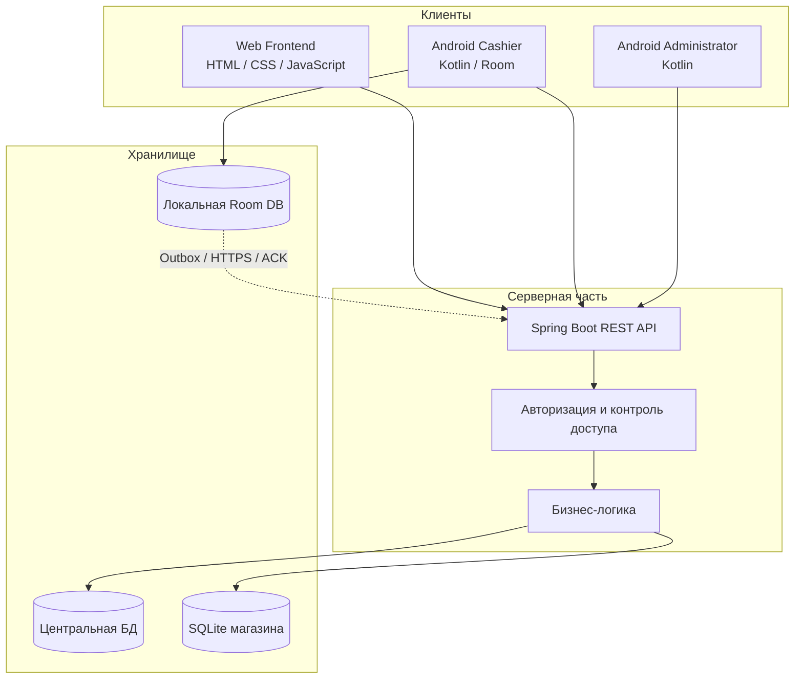

# Архитектура Ples ERP

Документ описывает систему на уровне компонентов для портфолио. Это обзор архитектуры, а не инструкция по развёртыванию и не полная спецификация API.

## Компоненты

### 1. Backend

- Java 21.
- Spring Boot 3.5.x.
- REST API для клиентских приложений.
- SQLite через JDBC-драйвер.
- Авторизация, роли и проверка доступа к магазину.
- Бизнес-операции с номенклатурой, поступлениями, продажами, возвратами и статистикой.

Сервер обязан проверять пользователя, роль и контекст магазина на своей стороне. Клиентский идентификатор магазина сам по себе не является доказательством доступа.

### 2. Web Frontend

- HTML, CSS и Vanilla JavaScript.
- Отдельные страницы веб-клиента.
- Использует Backend как источник бизнес-операций и данных.
- Не содержит отдельного серверного слоя Node.js; проект фронтенда — статические файлы.

### 3. Android Cashier

Кассовое приложение построено вокруг offline-first подхода:

1. Операция сохраняется локально в Room.
2. Она помещается в постоянную очередь Outbox.
3. WorkManager планирует фоновую отправку.
4. SyncEngine отправляет запрос по HTTPS.
5. Backend обрабатывает операцию и возвращает подтверждение (ACK).
6. Очередь фиксирует итоговый статус операции.

Используемые статусы очереди включают PENDING, PROCESSING, SENT, FAILED и CONFLICT. Для операции применяется уникальный идентификатор, который используется как ключ идемпотентности.

**Важно:** наличие интернета не означает, что каждая локальная операция уже синхронизирована. Состояние подтверждается отдельно для каждой операции.

### 4. Android Administrator

Отдельное Android-приложение для административных задач. По зафиксированному состоянию проекта в него входят:

- авторизация;
- поступления;
- номенклатура;
- история продаж;
- возвраты;
- статистика;
- просмотр сотрудников в режиме read-only.

Мобильная авторизация использует существующие Backend API. Токен хранится с применением Android Keystore и AES-GCM. Управление сотрудниками, которое относится к роли Supervisor, не переносится в Administrator.

## Схема взаимодействия

Схема показывает логические роли. Детали конкретного развёртывания, сетевые адреса и конфигурация намеренно не публикуются.

## Данные и изоляция магазинов

Серверная модель использует центральные данные для общих сущностей и отдельную SQLite-базу для каждого магазина. Запросы к данным магазина должны быть ограничены проверенным сервером контекстом пользователя и магазина.

Изменения схемы необходимо выполнять с учётом уже существующих данных и механизма инициализации. Нельзя удалять или пересоздавать рабочие базы ради демонстрации.

## Границы документа

- Этот документ не обещает, что все компоненты развернуты в публичном интернете.
- Публичная демонстрационная среда должна быть отделена от рабочего магазина.
- Для демонстрации необходимо использовать только синтетические данные и отдельные учётные записи.
- Полные секреты, токены, пароли, конфигурационные значения и реальные данные не публикуются.
- Перед коммерческим внедрением требуется отдельная проверка резервного копирования, восстановления, безопасности и эксплуатационных требований.
